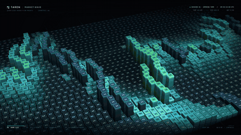
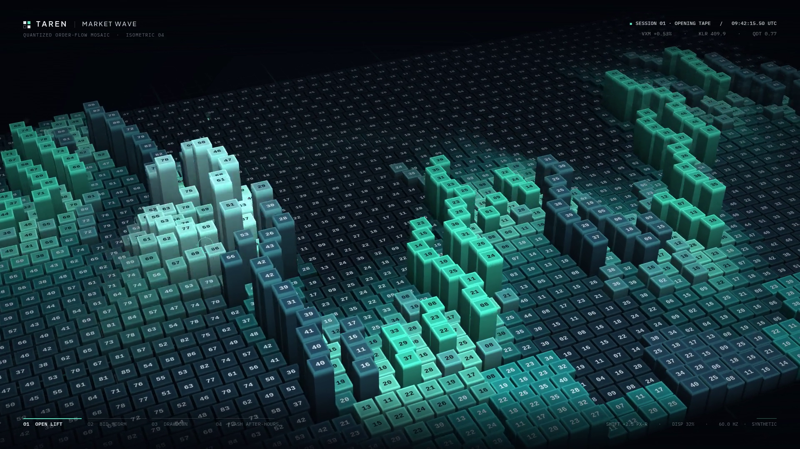
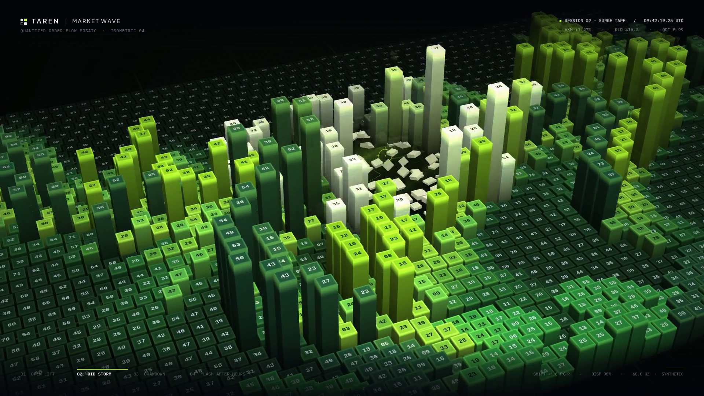
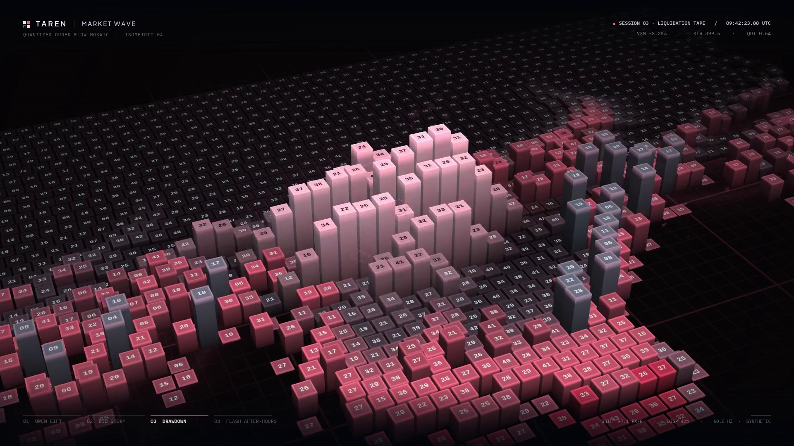
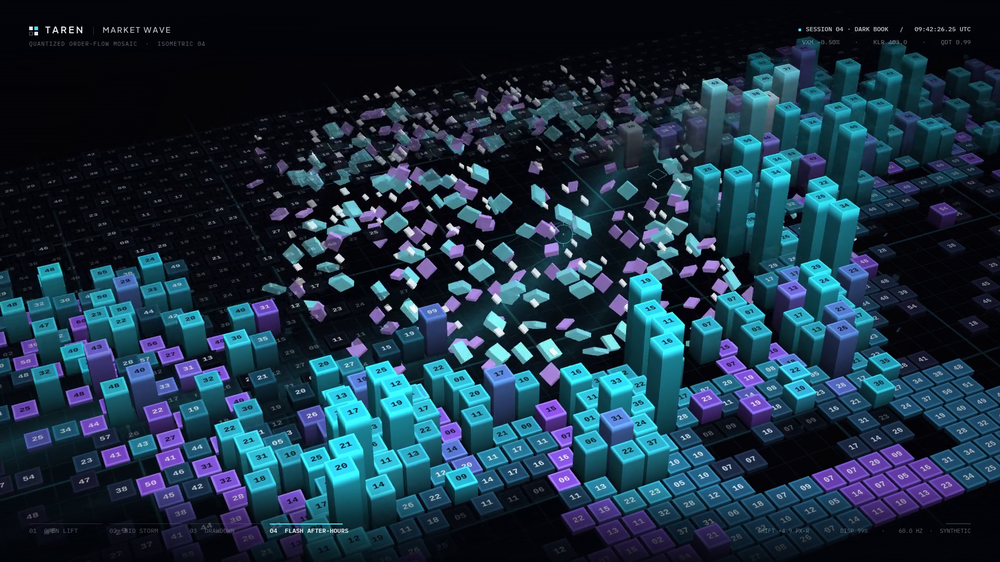

# TAREN — Market Wave

An original interactive Three.js isometric 3D pixel-mosaic market visualization with a deterministic 1080p60 video capture pipeline.

[](https://github.com/artem-kaseka/pixel-mosaic-market-wave/raw/main/pixel-mosaic-market-wave-1080p60.mp4)

> **Full 1080p60 Video (with synthesized stereo audio):** [Download / Watch `pixel-mosaic-market-wave-1080p60.mp4` (1920×1080, 60 fps, 15.0s, 30.5 MB)](https://github.com/artem-kaseka/pixel-mosaic-market-wave/raw/main/pixel-mosaic-market-wave-1080p60.mp4) · [View file in repo](./pixel-mosaic-market-wave-1080p60.mp4)

## Concept

A continuous synthetic market field—rolling price waves, stylized OHLC candlesticks, and foreground volume bars—is quantized into an isometric 3D grid of 2,432 instanced flat square tiles (`64 × 38`), each displaying a crisp flickering two-digit synthetic quote (`00`–`99`). Whole horizontal rows displace in response to moving wave crests and pointer disturbance; tiles extrude upward on lifts and sink into recessed trenches on drawdowns; trailing edges disperse into drifting data fragments; and volatility spikes or click-shocks detonate tile clusters into tumbling quantized particles before the grid heals.

All market series (`VXM`, `KLR`, `QDT`), branding (`TAREN`), palettes, and synthesized audio are 100% original and synthetic.

## Presets & Stills

| 01 Open Lift | 02 Bid Storm (Click-Shock) |
| :---: | :---: |
|  |  |
| **03 Drawdown** | **04 Flash After-Hours (Spike Dissolve)** |
|  |  |

## Running Live

Serve this directory over any local static HTTP server (required for ES modules):

```bash
python3 -m http.server 8080
```

Then open `http://127.0.0.1:8080/` in a WebGL-capable browser.

### Interactive Controls

- **Pointer / Touch Move**: Locally shears nearby rows horizontally, lifts/warps tiles along the wake, and sheds edge-dispersion particles.
- **Click / Tap** or **`Space`**: Triggers a localized volatility shock under the pointer—extruding tiles sharply, detonating a quantized cluster into 3D tumbling particles, and letting the grid heal back into place.
- **Keys `1`–`4`** (or click bottom-left preset labels):
  - `1` — **Open Lift**: Cool glacier teals and soft mint lifts, steady grinding wave, calm quote cadence.
  - `2` — **Bid Storm**: Electric chartreuse-lime on dark, rapid digit flicker, wide row displacement, frequent breakouts.
  - `3` — **Drawdown**: Deep crimson, rose, and cold iron, falling tape with recessed downward extrusion.
  - `4` — **Flash After-Hours**: Sparse near-black dark book, cyan/violet ticks, violent spike dissolves followed by a quiet heal.
- **`P`**: Pause / resume simulation.
- **`R`**: Reset series and timeline.

## Deterministic 1080p60 Capture

Requires Node.js, Chrome/Chromium (with SwiftShader WebGL2 support), and `ffmpeg`:

```bash
# Preview 6 key stills into stills/
node capture.mjs --preview-stills

# Render full 15.0s (900 frames) 1920x1080 60fps MP4 with subtle synthesized ambience
node capture.mjs
```
